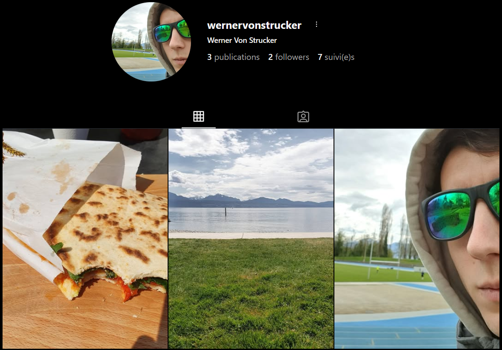
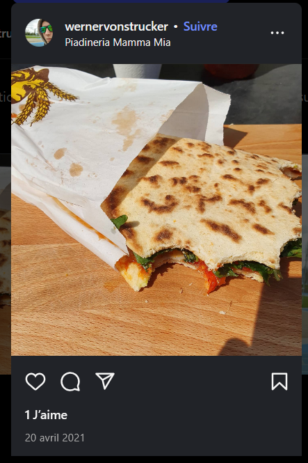
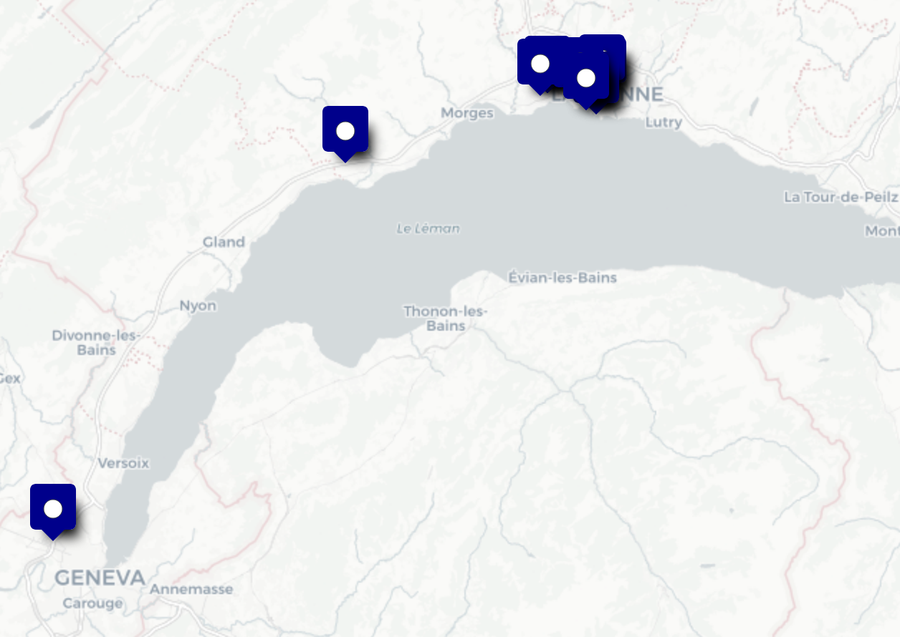
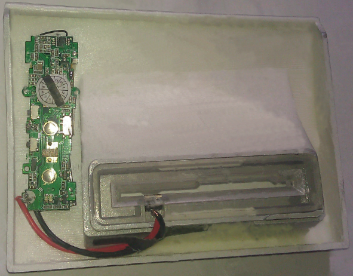

# *Examination*

> *La racine des chemins correspond à `Dump/data/`*

Pour examiner l'image, nous allons utiliser principalement le logiciel [Autopsy][]. Celui-ci permet d'analyser et d'extraire toutes les informations potentiellement utiles d'une image disque : métadonnées, conversations, journal d'appels, mails, contacts...

Nous allons commencer par montrer le plus visible, en allant vers les données plus compliquées à extraire, ce qui inclut les messages encodés, mentionnés précédemment comme étant pertinents.

## Mise en place de l'environnement de travail

### Installation d'[Autopsy][]

Pour installer [Autopsy][], il suffit de se rendre sur la [page de téléchargement](https://www.autopsy.com/download/). On peut l'installer sur GNU/Linux, MacOS et Windows, les instructions pour chaque OS sont détaillées sur le site officiel.

### Création du projet

Après installation, on peut créer le projet. On démarre [Autopsy][], on sélectionne `New Case`, puis on nomme le projet `Samsung`, par exemple.  
On remplit les informations optionnelles de manière adéquate, puis on finit la création du projet.

### Ajout des données

Après création du projet, on peut ajouter les données. Dans l'ordre :

1. `Generate new host name based on data source name`
2. `Logical files`
3. `Local files and folders`, puis on ajoute le `zip` directement.
4. On laisse tout coché, sauf `iOS analyzer` (et `Android Analyzer (aLEAPP)` si on n'a pas Windows)
5. On termine, et on attend patiemment la fin de l'analyse

### Exploitation des données

On a, à la fin de l'analyse, toutes les données retrouvées organisées dans différentes catégories.

![Organisation des données dans [Autopsy][]](figures/autopsy.png)

Cela va nous permettre d'examiner facilement toutes les données d'intérêt, chose que nous allons maintenant présenter.

## Identité

Commençons par présenter le propriétaire du téléphone : il se nomme Werner von Strucker.

{height=290px}

### Profil Instagram

L'analyse des fichiers d'application a révélé la présence d'Instagram sur l'appareil. L'examen du fichier de préférences `/data/data/com.instagram.android/shared_prefs/com.instagram. android_preferences.xml` a permis d'identifier le profil utilisateur :

```xml
username\&quot;:\&quot;wernervonstrucker\&quot;,\&quot;full_name\&quot;:\&quot; Werner Von Strucker
```

Cette découverte confirme l'identité du propriétaire et révèle l'utilisation du nom d'utilisateur `wernervonstrucker` sur la plateforme Instagram.

{height=200px}

### Contacts

[^bddGM]: `/data/com.google.android.gm/databases/peopleCache_vonstruckerwerner@gmail.com _com.google_11.db`

Une base de données GMail[^bddGM] donne un aperçu de ses contacts par mail. Notons les adresses qui ne proviennent pas de marques :

- `vonstruckerwerner@gmail.com` : vraisemblablement son adresse personnelle.
- `therealredskull41@gmail.com` : nous reviendrons sur Red Skull dans l'*Analysis*, voir \ref{analysis}.
- `arthur.kart@yopmail.com` : un contact personnel. Nous n'avons rien trouvé de plus à son sujet.


## Photographies

Dans les photos, un certain nombre semble intéressant.

### Corrélation avec Instagram

Deux des images postées sur Instagram correspondent exactement aux photos trouvées sur l'appareil mobile :

1. **Le selfie** : Identique à `/media/0/DCIM/Camera/IMG_20210411_144226.jpg` trouvé dans la galerie du téléphone

   <!--{height=200px}-->

2. **La photo de piadina** : Correspondant à `/media/0/DCIM/20210420_125202.jpg`, également trouvée sur l'appareil
   
   {height=200px}

   On remarque également un lieu posté avec ce met : **Piadineria Mamma Mia**, un restaurant italien situé à Lausanne.

Cette corrélation confirme de manière irréfutable l'appartenance du profil Instagram au propriétaire de l'appareil et établit un lien direct entre l'activité en ligne et les données présentes sur le dispositif mobile.

### Localisation

16 photos ont une localisation associée. [Autopsy][] permet d'extraire toutes ces localisations, et de les représenter sur une carte.  
On voit donc que l'utilisateur en a pris uniquement en Suisse, principalement aux abords de Lausanne.

{height=200px}

Cette observation est corroborée par le restaurant mentionné sur Instagram et confirme la présence du suspect dans la région lausannoise, renforçant ainsi la cohérence géographique de ses déplacements.

Parmi les photos intéressantes, on remarque une photo du logo d'[HYDRA][], datant du 8 avril 2021, avec un lien. Celui-ci est inaccessible, et nous n'avons pas pu trouvé d'informations à son sujet. Elle a été prise à l'Université de Lausanne, selon sa localisation.

![Logo d'[HYDRA][] - `/media/0/DCIM/Camera/20210408_182133.jpg`\label{fig:hydra}](figures/Export/20210408_182133.jpg){height=200px}

[^univ]: Puisqu'il serait né le 01/01/1980 d'après la Figure \ref{fig:infos}

Il y a deux autres photos à l'Université, cela montre qu'il est potentiellement professeur ou chercheur, et peut-être étudiant[^univ].

On trouve par ailleurs le fichier `/data/com.google.android.apps.maps/cache/image_manager_ disk_cache/08c1ccbdafb163c39925d5bbd6bab77c9f4c6012590ec3552e109f6026e591b3.0`, qui est une image cache de Google Maps de la commune de Bussigny, attenante à Lausanne, plus précisément de sa gare.

{height=200px}

[^hotel-prilly]: `/data/com.google.android.apps.maps/cache/image_manager_disk_cache/1d5071cb0596e4eed60b873 3663f2c720fa7d8c7f0d7645a2f5da89030c71c45.0`

[^gare-prilly]: `/data/com.google.android.apps.maps/cache/image_manager_disk_cache/b917b3ad6904cf85ccbabe0 c1d5103862540ebc5be61a2644a19568a102a3484.0`

On a aussi un hôtel[^hotel-prilly] (en retrouvant l'adresse indiquée par le pointeur) et la gare[^gare-prilly] de Prilly, une commune proche de Lausanne aussi.

{height=200px}

{height=200px}

[^gare-renens]: `/data/com.google.android.apps.maps/cache/image_manager_disk_cache/c231692d67d3c61df5f9aab dc84de244b22bfa0453ec5c3d6de5d56daeca21ab.0`

Enfin, on trouve la gare de Renens[^gare-renens], une troisième commune attenante à Lausanne.

{height=200px}

De plus, un évènement de calendrier dans `/data/com.android.providers.calendar/databases/ calendar.db-journal` renseigne un train entre Lausanne et Genève prévu pour le 20 avril à 16 h 45.

[^ICC]: [ICC][] est un centre d'affaires, proche de l'aéroport de Genève, qui loue des bureaux.

On remarque aussi deux photos éloignées de Lausanne, une prise en train, le 15 avril 2021 à 9 h 17, et une devant [ICC][][^ICC], à Genève, le même jour, à 10 h 05.

{height=200px}

![[ICC][] - `/media/0/DCIM/Camera/20210415_100517.jpg`\label{fig:icc}](figures/Export/20210415_100517.jpg){height=200px}

Enfin, une capture d'écran d'un vol Genève - New York, pour le 20 avril 2021, est retrouvé dans le cache du presse-papier. Il s'agit du vol avant lequel Werner a été appréhendé.

{height=300px}

Pour mieux comprendre la situation, il est nécessaire de déchiffrer les messages. Auparavant, terminons l'analyse des photos.


### Transactions Bitcoin Cash (BCH)

> On identifie les adresses BCH avec leurs 4 premiers et leurs 4 derniers caractères. On note une transaction de la même manière.

Une capture d'écran avec l'adresse BCH [qpuv-d23y](https://www.blockchain.com/fr/explorer/addresses/bch/qpuv475w4wytd6agujpzfl9muzajf9le45nkefd23y) est présente.

{height=300px}

En regardant sur la blockchain, on retrouve l'historique de transactions de cette adresse :

- [d14c-d8f2](https://www.blockchain.com/fr/explorer/transactions/bch/d14c75d148e7b4edbed737fbf6bef2e182aad47f30cd60f48c2a9176b73ad8f2)

    - Notre adresse a envoyé, avec [qzef-sezu](https://www.blockchain.com/fr/explorer/addresses/bch/qzefkuy2cwwhsuxyhpcly25nel6uavvrdqxzcfsezu), 0.00730765 BCH (\$4.34) à [qp9d-qxyj](https://www.blockchain.com/fr/explorer/addresses/bch/qp9d3p7nl4j9agx9t326a8nu4437yjm80yy4tpqxyj).
  
    - L'adresse de destination n'a aucune autre transaction, mais l'autre adresse d'envoi a [9084-0ac7](https://www.blockchain.com/explorer/transactions/bch/908401f77c051d6a7b74b28d486ae3c53cb89305e064c6c08d0c22fe6d9d0ac7)

        - [qzkl-kv4n](https://www.blockchain.com/fr/explorer/addresses/bch/qzklgmwtck0a4vg8fr203jhksmdym0k43yfschkv4n) et [qzs9-4k0c](https://www.blockchain.com/fr/explorer/addresses/bch/qzs90mtekda70zcdjsa95445sknntk4uhgp9zh4k0c) ont envoyé 0.00680453 BCH (\$4,04) à [qrxs-8h5p](https://www.blockchain.com/fr/explorer/addresses/bch/qrxs34f92tmu0z0vgskgrakx53ra7cmpxs29n68h5p) et [qzef-sezu](https://www.blockchain.com/fr/explorer/addresses/bch/qzefkuy2cwwhsuxyhpcly25nel6uavvrdqxzcfsezu)

	  - Les autres adresses ont d'autres transactions et adresses associés

- [bddf-e925](https://www.blockchain.com/explorer/transactions/bch/bddf7ed0ebfbb893208878f874266959c1780d49496bc061b41d6a93f361e925)

    - [qqvl-dnqz](https://www.blockchain.com/fr/explorer/addresses/bch/qqvlfrz3qds6hulxce7tyavlj7y20zm75vyze4dnqz) a envoyé 0.00175909 BCH (\$1,04) à [qpuh-8g3g](https://www.blockchain.com/fr/explorer/addresses/bch/qpuhlyvwekzgfczj5r08at6wcm4yrx6rlukdz98g3g) et notre adresse

    - L'adresse d'envoi a aussi la transaction [2845-de5f](https://www.blockchain.com/fr/explorer/transactions/bch/2845f76f97ec5bd192a627c113a619ed58ae0f66ac25f1b4bb058c7c5651de5f) associée

        - ...

Et ainsi de suite. Toutes les transactions semblent avoir eu lieu le 18 avril 2021.  
On a donc trouvé de nombreuses adresses BCH, dont les transactions s'entremêlent, pour ce qui semble être de l'obfuscation. Cela pourrait permettre de masquer ou compliquer :

- la chaîne de provenance (quelle adresse/quel portefeuille a fourni les fonds)
- la chaîne de destination (où les fonds vont ensuite)
- l'identité/attribution (lien entre adresse et personne ou service)
- la chronologie (quand les transferts ont eu lieu, y compris ordre et corrélation temporelle)
- le montant réel (par fragmentation ou autre)

## Messages

L'examen des données extraites du téléphone du suspect a permis de révéler la présence de messages illisibles reçus et envoyés, suggérant l'utilisation de méthodes d'encryption des messages.

Par exemple : `2 2 +41786909109  1617901761280 0  1 -1 2   HHY6cKEMFlNU3NPs/bxhxPKQ RyDXUrQK7a8tHtX5xBXdYQ=  0 0 1 it.feio.android.omninotes 1 0 0 228015930119996 0    0 0  0 0 0  0  0 0 0 0 0 0 0  0
`

L'analyse des métadonnées associées à ces messages met en évidence la provenance de ces messages, [OmniNotes][], une application open-source de prise de notes. Voir des messages cryptés depuis une application de prise de notes a priori non dédiée à l'envoi de message est un indicateur fort de tentative de dissimulation.

La prochaine étape est d'analyser le code source de cette application présent sur l'appareil pour identifier les méthodes utilisées.

### Examen du code source d'[OmniNotes][]

Pour extraire le code de l'application présente sur l'appareil, nous avons utilisé [apk2java-linux](https://github.com/TheZ3ro/apk2java-linux).

L'examen des fonctions a confirmé son rôle dans l'envoi de messages, notamment via l'appel d'une fonction dédiée à l'envoi.	

```{.java .numberLines}
public void putComm(View object) {
	object = (EditText)this.findViewById(2131296976);
        object = new TextHelper(this.getResources()).put(object.getText().toString());
        if (object.length() > 160) {
            Toast.makeText((Context)this, (CharSequence)ZipHelper.decomp("eJwFQLENwDAIe8UH5I1u6ZL2gQgs1AUPqEuuR1eanI 6bVTuIV8JUxsCi/0Y832ED99UM+Q=="), (int)0).show();
            return;
        }
        if (object.equals((Object)"")) {
            Toast.makeText((Context)this, (CharSequence)ZipHelper.decomp("eJwFgLEJACAMBFfJMpaCK6R4QhqV+/mLsOARB/2kb8 WWnaUBZ9oIuA=="), (int)0).show();
            return;
        }
        StringBuilder stringBuilder = new StringBuilder();
        stringBuilder.append(ZipHelper.decomp("eJwFQLEJADAMesU7+kOmXlCoSBYX7x /k0n8tDJMnHhQ48AYI"));
        stringBuilder.append((String)object);
        stringBuilder.append(" to ");
        stringBuilder.append(this.rsn());
        Toast.makeText((Context)this, (CharSequence)stringBuilder.toString(), (int)0).show();
        PendingIntent.getActivity((Context)this, (int)0, (Intent)new Intent((Context)this, CommActivity.class), (int)0);
        SmsManager.getDefault().sendTextMessage(this.rsn(), null, (String)object, null, null);
}
```

L'analyse a mis en évidence l'utilisation de blocs de données encodés :

```{.java .numberLines}
private String get_data() throws IOException, JSONException {
        String string2 = ZipHelper.decomp("eJwNyUsKwDAIBNATZSTbHietkH5wShUkt7frNyNe30Tm6hg PB3Z+ijztYDpM45eW3rrcunA5rQDMDhIV");
        Object object = new StringBuilder();
        object.append(string2);
        object.append(ZipHelper.decomp("eJwFwIEIAAAAACC0/a1OAEAAQA=="));
        object.append(ZipHelper.decomp(this.resources.getString(2131821101)));
        string2 = (HttpsURLConnection)new URL(object.toString()).openConnection();
        try {
            String string3;
            object = new BufferedReader((Reader)new InputStreamReader(string2.getInputStream()));
            Object object2 = new StringBuffer();
            while ((string3 = object.readLine()) != null) {
                object2.append(string3);
            }
            object = new JSONObject(String.valueOf((Object)object2)).getString("key");
            object2 = new SimpleDateFormat(ZipHelper.decomp("eJwNwIEAAAAMhECiULJ4idm3u4eyBRWSA6E="), Locale.getDefault()).format(new Date());
            string3 = new StringBuilder();
            string3.append((String)object);
            string3.append((String)object2);
            object = string3.toString();
            return object;
        }
        finally {
            string2.disconnect();
        }
}
```

Avec des bouts de code codés en `base64` et compressé en [zlib](https://www.zlib.net/), identifiable grâce au préfixe `eJw` :

- `eJwNyUsKwDAIBNATZSTbHietkH5wShUkt7frNyNe30Tm6hgPB3Z+ijztYDpM45eW3rrcunA5rQ DMDhIV` nous donne le lien vers un site nous permettant de récupérer une clé : `rb5CuefkDLyb9T`
- `eJwNwIEAAAAMhECiULJ4idm3u4eyBRWSA6E` nous donne `yyyy-MM-dd`.

En analysant ce bout de code on comprend que l'on va récupérer la clé sur le site Web, on récupère aussi la date actuelle que l'on va mettre sous format `yyyy-MM-dd` et que l'on va concaténer à la clé. Ce qui va nous donner une nouvelle clé permettant de coder les messages à partir d'une clé statique et d'une clé dépendant de paramètres temporels.  
Par exemple, un message envoyé le 15 Avril 2021 sera codé via la clé `rb5CuefkDLyb9T2021-04-15`.

 
Le code a permis de déterminer l'utilisation de l'algorithme de chiffrement par bloc AES dans le mode ECB avec le schéma PKCS5Padding :

```{.java .numberLines}
private byte[] save_msg(String string2) throws NoSuchAlgorithmException, NoSuchPaddingException, InvalidKeyException, InvalidParameterSpecException, IllegalBlockSizeException, BadPaddingException, IOException, JSONException {
        SecretKeySpec secretKeySpec = new SecretKeySpec(this.get_data().getBytes(), "AES");
        Cipher cipher = Cipher.getInstance((String)"AES/ECB/PKCS5Padding");
        cipher.init(1, (Key)secretKeySpec);
        return cipher.doFinal(string2.getBytes("UTF-8"));
}
```

Après avoir crypté le message de cette façon, on va rajouter `HHY` devant ce message pour que l'application puisse différencier les messages chiffrés de ceux qui ne le sont pas.

```{.java .numberLines}
public String put(String string2) {
        try {
            StringBuilder stringBuilder = new StringBuilder();
            stringBuilder.append("HHY");
            stringBuilder.append(Base64.encodeToString((byte[])this.save_msg(string2), (int)2));
            return stringBuilder.toString();
        }
        catch (IOException | InvalidKeyException | NoSuchAlgorithmException | InvalidParameterSpecException | BadPaddingException | IllegalBlockSizeException | NoSuchPaddingException | JSONException noSuchPaddingException) {
            return "";
        }
}
```

<!--IL MANQUE UN IF ICI-->

Pour résumer, on va coder les messages de la manière suivante :

$$\text{HHY}+\text{base64}(\text{AES avec clé hybride}(\text{Message Clair}))$$

Pour décoder on va donc :

1. enlever `HHY` du message crypté
2. traduire depuis la base64
3. décoder AES grâce à la clé créée à partir de `rb5CuefkDLyb9T` et de la date d'envoi du message

Cela nous a permis de pouvoir lire les 42 messages qui ont été jusqu'alors illisibles.

### Messages décodés \label{messages-dec}

Voici une partie de ces messages considérés comme les plus importants pour notre travail.

#### 8 avril 2021

Heil Hydra \emoji{octopus}!
:   `6cKEMFlNU3NPs/bxhxPKQRyDXUrQK7a8tHtX5xBXdYQ=`


#### 15 avril 2021

We need to meet you. Get to geneva asap, further instructions will follow.
:   `HHYbm0j yH9MsbIM1DsyvNU9iDm63RQa9/1Fxfrs/A75m3wAM04VwDGphJ4m9IUTjPQ//3qbJmQk xQQeu 50WmK0zLHj93BiByuFEHsvHwzcfHsI`

understood, was headed to geneva anyway, already on a train.
:   `S6+p9IajgCnkXIm0tou uBzw/c5dSk4ZVzCEeA7BZmnR7+J5ybgmhLeXCyxpwovM8yFaK1NQtfAJXHKwHnMGIxg==`

Good. Meet us at our base. Below the Turkish consulate. Delete this message once read!
:   `HHYcdZD5nSpEbiNiPHaMn/eJR3qfnG1bBjxHLgN2Q91Jjx+DaAtq15BuatyPqSSH0ZOqLPbis2 11525r4RIkumQSF1p8xjb7tbOHzWN250Sqmoh9v+9kcE6lnWMOcYHo4ub`


## Skimming

**Phrase d'introduction pour garder un lien avec les parties.**


L'enregistrement intitulé `2021_04_09T1621` présente des éléments suspects. Après une première écoute, il apparaît presque vide, ne contenant que deux bruits sourds. Or, la personne mise en cause dans cette affaire fait l'objet de soupçons de fraude à la carte bancaire et les autorités ont retrouvés un dispositif suspect sur un distributeur automatique de billets (ATM) à Genève.

Après quelques recherches, il apparaît que l'appareil retrouvé sur l'ATM pourrait correspondre à un **skimming device**, c'est-à-dire un dispositif destiné à copier frauduleusement les informations contenues sur la bande magnétique d'une carte bancaire lorsque celle-ci est insérée dans un lecteur.

**[Schéma de fonctionnement]**

Des exemples de skimming devices disponibles en ligne montrent que certains comportent également une piste audio et sont appelés « audioskim ». Il est donc plausible que l'enregistrement provienne de cet appareil. De plus, le titre de l'enregistrement, incluant une date, suggère qu'il correspond à une capture audio réalisée à un instant précis et conforte la thèse de l'enregistrement de données de carte bancaire.

{height=200px}


### Fonctionnement d'un *skimming device*

