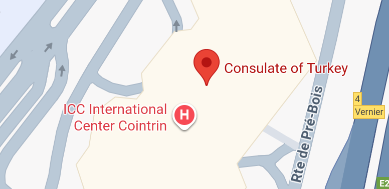

# *Analysis*

## Identité et lien avec [HYDRA][]

Tout d'abord, le nom de l'utilisateur est celui d'un personnage fictif de Marvel, lié à [HYDRA][]. Cette dernière est une organisation terroriste de fiction, du même univers. Pour plus d'informations : <https://en.wikipedia.org/wiki/Werner_von_Strucker>.

Dans les contacts mail de l'incriminé, on retrouve `therealredskull41@gmail.com`. [Red Skull](https://en.wikipedia.org/wiki/Red_Skull) est un personnage fictif du même univers que Werner von Strucker.

Dans les photographies, nous avons retrouvé un logo d'[HYDRA][], en figure \ref{fig:hydra}, qui a été prise à l'Université de Lausanne, le 8 avril 2021.

On peut en déduire que Werner a potentiellement rejoint l'organisation en étant approché à l'Université, qu'il y ait été étudiant ou professeur.

Les messages décodés (voir \ref{messages-dec}) vont aussi en ce sens : le *Heil Hydra \emoji{octopus}!* semble avoir été envoyé lorsqu'il a rejoint l'organisation.

Par ailleurs, le fait que les messages ait été échangés via [OmniNotes][] montre la volonté de dissimuler sa relation avec [HYDRA][].

## Voyage à Genève

La conversation du 15 avril 2021 montre qu'il se rendait à Genève pour rencontrer l'organisation.

On voit sur la figure \ref{fig:icc} qu'il se trouvait près d'[ICC][] le 15 avril 2021.

On remarque qu'[ICC][] est situé à proximité du consulat de Turquie.

{height=175px}

Cela fait donc sens avec les messages : Werner s'est rendu à Genève pour rencontrer [HYDRA][], peut-être dans un bureau d'[ICC][]

On a remarqué précédemment (voir \ref{localisation})

## Implication dans le Skimming

Les adresses BCH 
