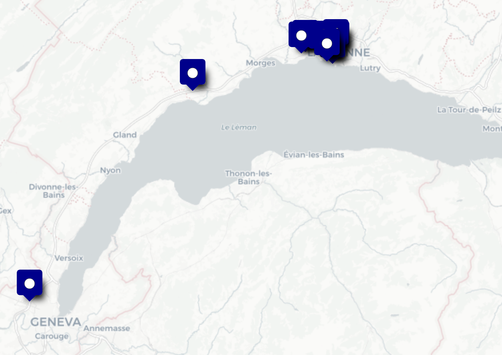

<!--Liens-->
[Autopsy]: https://www.autopsy.com/
[HYDRA]: https://fr.wikipedia.org/wiki/HYDRA
[OmniNotes]: https://omninotes.app/
[zlib]: https://www.zlib.net/


# Introduction{-}

[^Locard]: Chaque interaction laisse une trace
[^5WH]: Who, what, when, where, why, and how

L'objectif de ce premier projet de *Mobile Forensic* est de réaliser une investigation sur une image de smartphone, dans un contexte préétabli, afin de mettre en évidence des preuves numériques pertinentes pour une enquête.

Par définition, la *Digital Forensics*, ici appliqué aux environnements mobiles, regroupe *l'ensemble de méthodes et d'outils visant à récupérer, préserver et examiner des preuves numériques issues ou transmises par des dispositifs électroniques*.  
Ce domaine s'appuie sur le principe de Locard[^Locard], et vise à répondre aux 5WH[^5WH].

L'investigation doit préserver l'intégrité des preuves et garantir une acquisition recevable juridiquement, en maintenant une chaîne de confiance.

Le processus légal d'investigation est souvent le suivant :

1. Identification
   :   Détection de l'incident, reconnaissance et sécurisation des sources de preuves.
2. Collection
   :   Acquisition des données de l'appareil avec des méthodes garantissant l'intégrité (copies, empreintes numériques).
3. Examination
   :   Extraction, tri et préparation des données pertinentes (fichiers, métadonnées, artefacts cachés).
4. Analysis
   :   Interprétation des preuves pour établir les faits, reconstituer les événements et relier les acteurs.
5. Presentation
   :   Restitution structurée des résultats sous forme de rapport recevable juridiquement.

Pour ce travail, les étapes d'*Identification* et de *Collection* ont déjà été effectués. Nous les présenterons dans un premier temps, avant de présenter successivement nos résultats pour *Examination* et *Analysis*. Ce rapport, dans son ensemble, constitue la phase de *Presentation*.


# *Identification* et *Collection*

> L'enquête présentée dans ce rapport s'inscrit dans une progression en 5 étapes du [Challenge 2021 de la DFRWS](https://dfrws.org/dfrws-2021-challenge), nous en sommes à la troisième étape.

Le 9 avril 2021, un dispositif de skimming a été découvert sur un distributeur automatique de la Poste suisse, à Lausanne. Une micro-SD intégrée au dispositif a été saisie et a révélé des traces d'utilisation frauduleuse liées à des cartes bancaires.

À partir de ces informations, une perquisition a été menée le 18 avril 2021 à Aoste, Italie, où un laboratoire de fabrication a été découvert. Un Raspberry Pi connecté à une imprimante 3D a pu être saisi. Une copie de sa micro-SD a permis d'étudier son rôle éventuel dans la production d'objets illicites.

L'exploitation de ces premiers résultats a conduit à l'identification d'un suspect, interpellé le 20 avril 2021 à l'aéroport de Genève alors qu'il tentait de voyager avec un billet acheté à l'aide d'une carte bancaire volée. Son téléphone a été saisi et une image complète du système de fichiers a été extraite le lendemain. Une analyse préliminaire a révélé la présence de SMS encodés, susceptibles de contenir des éléments de preuve pertinents pour la compréhension des faits.

Notre investigation se basera donc sur l'image en question.


***

- <https://cfreds.nist.gov/all/FrancescoServida%2FDFRWS/SamsungGalaxyS10Android10DFRWS2021>
- SHA2-256 : `54877505f1b4eb26c4cb6b43fd6338424660c207e678b773044a4a79d6e374b7`


# *Examination*

[^werner]: Il s'agit du nom d'un caractère fictif de Marvel, lié à [HYDRA][]. Voir <https://en.wikipedia.org/wiki/Werner_von_Strucker>

Pour examiner l'image, nous allons utiliser principalement le logiciel [Autopsy][]. Celui-ci permet d'analyser et d'extraire toutes les informations potentiellement utiles d'une image disque : métadonnées, conversations, journal d'appels, mails, contacts...

Nous allons commencer par montrer le plus visible, en allant vers les données plus compliquées à extraire, ce qui inclus les messages encodés, mentionnés précédemment comme étant pertinents.

## Mise en place de l'environnement de travail

Comment configurer le projet dans Autopsy ?

### Installation d'Autopsy


## Identité

Commençons par présenter le propriétaire du téléphone : il se nomme Werner von Strucker[^werner].

{height=400px}


## Photographies

Dans les photos, un certain nombre semble intéressant.

Tout d'abord, un selfie de Werner.

{height=200px}

Par ailleurs, une photo d'une *piadina*, scène triviale d'alimentation, illustre qu'il emploie son téléphone à titre personnel. D'autres photos vont dans ce sens.

{height=200px}

## Localisation

16 photos ont une localisation associée. On voit donc que l'utilisateur en a pris uniquement en Suisse, principalement aux abords de Lausanne.



## Contacts

[^bddGM]: `Dump/data/data/com.google.android.gm/databases/`  
`peopleCache_vonstruckerwerner@gmail.com_com.google_11.db`

Une base de données GMail[^bddGM] donne un aperçu de ses contacts. Notons l'adresse `therealredskull41@gmail.com`. En effet, [Red Skull](https://en.wikipedia.org/wiki/Red_Skull) est un personnage fictif du même univers que Werner von Strucker.


## Messages

L'examen des données extraites du téléphones du suspect a permis de révéler la présence de messages illisibles reçus et envoyés, suggérant l'utilisation de méthodes d'encryption des messages.

Par exemple : `2 2 +41786909109  1617901761280 0  1 -1 2   HHY6cKEMFlNU3NPs/bxhxPK QRyDXUrQK7a8tHtX5xBXdYQ=  0 0 1 it.feio.android.omninotes 1 0 0 228015930119996 0    0 0  0 0 0  0  0 0 0 0 0 0 0  0
`

L'analyse des métadonnées associées à ces messages met en évidence la provenance de ces messages, [OmniNotes][], une application open-source de prise de notes. Voir des messages cryptés depuis une application de prise de notes a priori non dédiée à l'envoi de message est un indicateur fort de tentative de dissimulation.

La prochaine étape est d'analyser le code source de cette application présent sur l'appareil pour identifier les méthodes utilisées.

L'examen des fonctions a confirmé son rôle dans l'envoi de messages, notamment via l'appel d'une fonction dédiée à l'envoi.	

```{.java .numberLines}
public void putComm(View object) {
	object = (EditText)this.findViewById(2131296976);
        object = new TextHelper(this.getResources()).put(object.getText().toString());
        if (object.length() > 160) {
            Toast.makeText((Context)this, (CharSequence)ZipHelper.decomp("eJwFQLENwDAIe8UH5I1u6ZL2gQgs1AUPqEuu R1eanI6bVTuIV8JUxsCi/0Y832ED99UM+Q=="), (int)0).show();
            return;
        }
        if (object.equals((Object)"")) {
            Toast.makeText((Context)this, (CharSequence)ZipHelper.decomp("eJwFgLEJACAMBFfJMpaCK6R4QhqV+/ mLsOARB/2kb8WWnaUBZ9oIuA=="), (int)0).show();
            return;
        }
        StringBuilder stringBuilder = new StringBuilder();
        stringBuilder.append(ZipHelper.decomp("eJwFQLEJADAMesU7+kOmXlCoSBY X7x/k0n8tDJMnHhQ48AYI"));
        stringBuilder.append((String)object);
        stringBuilder.append(" to ");
        stringBuilder.append(this.rsn());
        Toast.makeText((Context)this, (CharSequence)stringBuilder.toString(), (int)0).show();
        PendingIntent.getActivity((Context)this, (int)0, (Intent)new Intent((Context)this, CommActivity.class), (int)0);
        SmsManager.getDefault().sendTextMessage(this.rsn(), null, (String)object, null, null);
}
```

L'analyse a mis en évidence l'utilisation de blocs de données encodés :

```{.java .numberLines}
private String get_data() throws IOException, JSONException {
        String string2 = ZipHelper.decomp("eJwNyUsKwDAIBNATZSTbHietkH5wShUkt7frNyNe30Tm6hg PB3Z+ijztYDpM45eW3rrcunA5rQDMDhIV");
        Object object = new StringBuilder();
        object.append(string2);
        object.append(ZipHelper.decomp("eJwFwIEIAAAAACC0/a1OAEAAQA=="));
        object.append(ZipHelper.decomp(this.resources.getString(2131821101)));
        string2 = (HttpsURLConnection)new URL(object.toString()).openConnection();
        try {
            String string3;
            object = new BufferedReader((Reader)new InputStreamReader(string2.getInputStream()));
            Object object2 = new StringBuffer();
            while ((string3 = object.readLine()) != null) {
                object2.append(string3);
            }
            object = new JSONObject(String.valueOf((Object)object2)).getString("key");
            object2 = new SimpleDateFormat(ZipHelper.decomp("eJwNwIEAAAAMhECiULJ4idm3u4eyBRWSA6E="), Locale.getDefault()).format(new Date());
            string3 = new StringBuilder();
            string3.append((String)object);
            string3.append((String)object2);
            object = string3.toString();
            return object;
        }
        finally {
            string2.disconnect();
        }
}
```

Avec des bouts de code codés en `base64` et compressé en [zlib][], identifiable grâce au préfixe `eJw` :

- `eJwNyUsKwDAIBNATZSTbHietkH5wShUkt7frNyNe30Tm6hgPB3Z+ijztYDpM45eW3rrcunA5rQ DMDhIV` nous donne le lien vers un site nous permettant de récupérer une clé : `rb5CuefkDLyb9T`
- `eJwNwIEAAAAMhECiULJ4idm3u4eyBRWSA6E` nous donne `yyyy-MM-dd`.

En analysant ce bout de code on comprend que l'on va récupérer la clé sur le site Web, on récupère aussi la date actuelle que l'on va mettre sous format `yyyy-MM-dd` et que l'on va concaténer à la clé. Ce qui va nous donner une nouvelle clé permettant de coder les messages à partir d'une clé statique et d'une clé dépendant de paramètres temporels.

Par exemple, un message envoyé le 15 Avril 2021 sera codé via la clé `rb5CuefkDLyb9T2021-04-15`.

 
Le code a permis de déterminer l'utilisation de l'algorithme de chiffrement par bloc AES dans le mode ECB avec le schéma PKCS5Padding :

```{.java .numberLines}
private byte[] save_msg(String string2) throws NoSuchAlgorithmException, NoSuchPaddingException, InvalidKeyException, InvalidParameterSpecException, IllegalBlockSizeException, BadPaddingException, IOException, JSONException {
        SecretKeySpec secretKeySpec = new SecretKeySpec(this.get_data().getBytes(), "AES");
        Cipher cipher = Cipher.getInstance((String)"AES/ECB/PKCS5Padding");
        cipher.init(1, (Key)secretKeySpec);
        return cipher.doFinal(string2.getBytes("UTF-8"));
}
```

Après avoir crypté le message de cette façon, on va rajouter `HHY` devant ce message pour que l'application puisse différencier les messages chiffrés de ceux qui ne le sont pas.

```{.java .numberLines}
public String put(String string2) {
        try {
            StringBuilder stringBuilder = new StringBuilder();
            stringBuilder.append("HHY");
            stringBuilder.append(Base64.encodeToString((byte[])this.save_msg(string2), (int)2));
            return stringBuilder.toString();
        }
        catch (IOException | InvalidKeyException | NoSuchAlgorithmException | InvalidParameterSpecException | BadPaddingException | IllegalBlockSizeException | NoSuchPaddingException | JSONException noSuchPaddingException) {
            return "";
        }
}
```

<!--IL MANQUE UN IF ICI-->

Pour résumer on va coder les messages de la manière suivante :

$$\text{HHY}+\text{base64}(\text{AES avec clé hybride}(\text{Message Clair}))$$

Pour décoder on va donc :

1. enlever `HHY` du message crypté
2. traduire depuis la base64
3. décoder AES grâce à la clé créée à partir de `rb5CuefkDLyb9T` et de la date d'envoi du message

Cela nous a permis de pouvoir pouvoir lire les 42 messages qui ont été jusqu'alors illisibles.

Voici une partie de ces messages considérés comme les plus importants pour notre travail.

### Messages isolés

<!--6cKEMFlNU3NPs/bxhxPKQRyDXUrQK7a8tHtX5xBXdYQ= → Heil Hydra 🐙!-->


### Conversation donnant des informations utiles

Du 15 avril 2021 :

We need to meet you. Get to geneva asap, further instructions will follow.
:   `HHYbm0jyH9MsbIM1DsyvNU9iDm63RQa9/1Fxfrs/A75m3wAM04VwDGphJ4m9IUTjPQ//3qbJmQk xQQeu50WmK0zLHj93BiByuFEHsvHwzcfHsI`

understood, was headed to geneva anyway, already on a train.
:   `S6+p9IajgCnkXIm0tou uBzw/c5dSk4ZVzCEeA7BZmnR7+J5ybgmhLeXCyxpwovM8yFaK1NQtfAJXHKwHnMGIxg==`

Good. Meet us at our base. Below the Turkish consulate. Delete this message once read!
:   `HHYcdZD5nSpEbiNiPHaMn/eJR3qfnG1bBjxHLgN2Q91Jjx+DaAtq15BuatyPqSSH0ZOqLPbis2 11525r4RIkumQSF1p8xjb7tbOHzWN250Sqmoh9v+9kcE6lnWMOcYHo4ub`


## Skimming

### Transactions Bitcoin


# *Analysis*


# Conclusion{-}

Suite à l'analyse du téléphone du suspect, nous avons été en mesure d'établir clairement :

- Qu'il fait partie de l'organisation fictive [HYDRA][]
